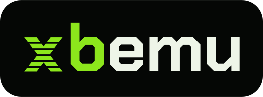

  

  
  
  
  

xbemu is an original Xbox emulator core written in Rust. It runs games and
homebrew straight from a disc image: there is no BIOS to supply and no
dashboard to boot, because the console's kernel is reimplemented on the host.

It is early. Linux x86-64 is the only platform so far; `docs/status.md` says
what works today.

- **Documentation and developer reference:** <https://docs.xbemu.org>
- **Builds:** every commit to `main` publishes a pre-release on the
  [releases page](https://github.com/emuforge/xbemu/releases).
- **Building from source:** [`docs/development.md`](docs/development.md)

## Credits and license

xbemu is derived from [xbased](https://github.com/crazyriddler/xbased), which
builds on [hakuX](https://github.com/rfandango/hakuX) and
[xemu](https://github.com/xemu-project/xemu). It is licensed under the GNU
General Public License, version 3 or later ([`COPYING`](COPYING)). Full
credits are in [`ATTRIBUTION.md`](ATTRIBUTION.md).

No game, BIOS or other console data is included or distributed with xbemu.
